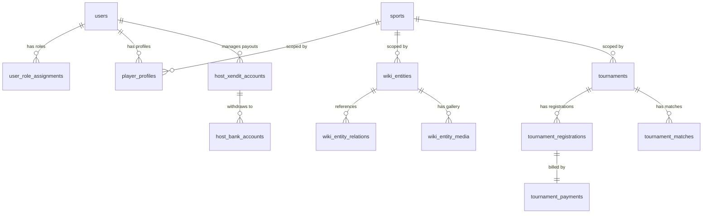

# Analisis Mendalam Aplikasi TandingBase

Aplikasi **TandingBase** (juga disebut sebagai **Court Pedia** di beberapa modul dan dokumen lama) adalah platform ensiklopedia olahraga modern berbasis komunitas dengan konsep serupa **Liquipedia**. Sistem ini dirancang secara modular dan dapat diperluas untuk mencakup berbagai jenis olahraga dengan fokus awal pada olahraga **Padel (padel-first MVP)**.

Dokumen ini berisi analisis lengkap dan detail mengenai arsitektur, struktur proyek, sistem otorisasi, skema database, alur transaksi pembayaran (Xendit & XenPlatform), penanganan media, serta prosedur deployment dan keamanannya.

---

## 1. Visi & Konsep Aplikasi

TandingBase didirikan dengan tujuan menjadi pusat informasi dan aktivitas komunitas olahraga. MVP (Minimum Viable Product) aplikasi ini berfokus pada olahraga Padel, namun sistem data didesain dengan model **Multi-Sport**:
* **Multi-Sport Model**: Setiap entitas utama dalam sistem dihubungkan ke tabel `sports` melalui foreign key `sport_id`. Penambahan olahraga baru (seperti tennis, badminton, atau billiard) dapat dilakukan secara aditif tanpa merestrukturisasi skema database.
* **Liquipedia-Style Wiki**: Halaman ensiklopedia berisi profil atlet/pemain, tim, dan peralatan (raket, bola, dsb.) yang dapat diperbarui oleh komunitas (editor/host) dan dimoderasi sebelum dipublikasikan.
* **Community & Tournament Hub**: Selain wiki, aplikasi ini memfasilitasi aktivitas nyata seperti pembuatan klub, registrasi turnamen resmi/berbayar, bagan tanding (brackets), serta pencatatan skor langsung (live scores).

---

## 2. Spesifikasi Stack Teknologi

Aplikasi ini menggunakan teknologi modern dan kokoh untuk mendukung skalabilitas tinggi serta performa optimal:

| Komponen | Teknologi | Keterangan / Fungsi |
| :--- | :--- | :--- |
| **Framework Utama** | Next.js 16 (App Router), TypeScript | Routing berbasis folder `app/`, Server Components, API routes yang efisien. |
| **Styling & UI** | Tailwind CSS, shadcn/ui, framer-motion | Tampilan premium dengan animasi mikro halus dan komponen terstandarisasi. |
| **Database & ORM** | PostgreSQL + Drizzle ORM | Database relasional untuk integritas data tinggi, dimanage menggunakan Drizzle ORM. |
| **Cache & Session** | Redis (ioredis) | caching halaman publik, rate limiter API, tracking sesi sekunder, pub/sub skor langsung. |
| **Object Storage** | SeaweedFS (via S3 API / filer HTTP) | Penyimpanan file gambar (avatar, galeri turnamen, foto alat olahraga). |
| **Autentikasi** | Better Auth + Firebase Google OAuth | Autentikasi aman dengan perlindungan brute force (lockout) dan integrasi login Google. |
| **Payment Gateway** | Xendit + XenPlatform | Pengumpulan biaya registrasi turnamen dan split payout otomatis ke rekening penyelenggara (host). |

---

## 3. Struktur Proyek & Kode Sumber

Arsitektur folder dirancang dengan memisahkan boundary client dan server secara ketat:

```
court-pedia/
├── app/                  # Route halaman, layout, dan API Handlers (Next.js App Router)
├── components/           # UI presentasional, komponen shadcn, dashboard, & tata letak
├── db/                   # Skema Drizzle, file client, migrasi, dan seed database
│   ├── migrations/       # File migrasi SQL hasil generate Drizzle
│   ├── schema/           # Modul-modul skema database terpisah (auth, wiki, payment, dll.)
│   └── seed.ts           # Seeding awal cabang olahraga (Padel) dan roles
├── docs/                 # Panduan arsitektur, keamanan, deployment, & integrasi Xendit
├── hooks/                # Custom React hooks untuk fungsionalitas sisi klien
├── lib/                  # Logika bisnis inti (Services, Storage Adapters, API Helpers)
│   ├── auth/             # Konfigurasi Better Auth, guard role, dan fungsi sesi
│   ├── config/           # Validasi variabel lingkungan (Zod) dan meta situs
│   ├── payments/         # Integrasi API Xendit & XenPlatform
│   ├── storage/          # Adapter S3 dan HTTP filer untuk SeaweedFS
│   ├── health/           # Logika agregasi pengecekan kesehatan infrastruktur
│   └── errors.ts         # Taksonomi kesalahan aplikasi (AppError)
├── ops/                  # Konfigurasi container opsional seperti cron sidecar
├── public/               # Aset statis publik (ikon, gambar default)
├── scripts/              # CLI scripts untuk administrasi, migrasi, & cek infra
└── package.json          # Manajemen dependensi dan script NPM
```

---

## 4. Sistem Hak Akses (Role & Permission)

TandingBase menerapkan sistem **Role-Based Access Control (RBAC)** multi-level yang fleksibel. Hak akses disimpan di tabel khusus `user_role_assignments` (mendukung banyak role per pengguna):

### Peran (Roles) Aplikasi

1. **Player**
   * Peran default untuk anggota komunitas setelah mendaftar.
   * Dapat membuat profil pemain (`player_profiles`) per cabang olahraga, bergabung dengan klub, mendaftar ke turnamen, dan berpartisipasi dalam matchmaking sesuai tingkat kemahiran (Bronze, Silver, Gold).
2. **Host**
   * Dahulu dinamakan *contributor* atau *editor*.
   * Diperuntukkan bagi penyelenggara turnamen dan kontributor wiki.
   * Memiliki akses ke Host Workspace untuk membuat dan mengelola turnamen serta melakukan pengeditan konten ensiklopedia wiki (dengan moderasi).
3. **Super Admin**
   * Kontrol penuh atas platform, manajemen pengguna, modifikasi cabang olahraga, dan persetujuan moderasi wiki.
   * Mengakses Master Console di `/admin`.

### Mekanisme Pengamanan Sesi & Lockout
* Menggunakan **Better Auth** dengan proteksi rate limit ketat pada path sensitif (`/sign-in`, `/sign-up`, `/forget-password`).
* **Auth Lockout**: Diimplementasikan lewat Redis (`lib/security/auth-lockout.ts`). Jika pengguna gagal login sebanyak 5 kali dalam periode tertentu, akun akan dikunci selama 15 menit.

---

## 5. Analisis Skema Database Utama

Database dimigrasikan menggunakan UUID untuk integritas ID global dan diatur secara modular di dalam `db/schema/`:



### Tabel-Tabel Inti:
1. **Otorisasi & Akun (`auth.ts`, `roles.ts`)**
   * `users`, `sessions`, `accounts`, dan `verification` mengelola kredensial dan sesi Better Auth.
   * `user_role_assignments` memetakan pengguna ke role `player`, `host`, atau `super_admin`.
2. **Ensiklopedia Wiki (`wiki.ts`, `sports.ts`)**
   * `sports`: Menyimpan data cabang olahraga (nama, slug unik, visibility).
   * `wiki_entities`: Berisi entitas wiki seperti profil atlet (bukan akun pengguna), tim, atau alat olahraga (`entity_type` ∈ `['player', 'team', 'gear']`).
   * `wiki_entity_relations`: Pemetaan relasi antar entitas wiki (mis. pemain X bermain di tim Y, raket Z dipakai oleh pemain X).
3. **Turnamen & Kompetisi (`tournaments.ts`, `tournament-registration.ts`, `tournament-matches.ts`)**
   * `tournaments`: Menyimpan data turnamen (nama, deskripsi, tanggal, tipe registrasi, biaya pendaftaran).
   * `tournament_registrations`: Registrasi tim/pemain ke turnamen dengan status `pending_payment`, `confirmed`, atau `cancelled`.
   * `tournament_matches`: Struktur bagan tanding, babak, skor langsung, dan pemenang pertandingan.
4. **Keuangan & Payout Host (`host-xendit.ts`, `host-bank-accounts.ts`, `tournament-payments.ts`)**
   * `host_xendit_accounts`: Menyimpan ID sub-account XenPlatform milik host penyelenggara turnamen.
   * `host_bank_accounts`: Informasi rekening bank untuk pencairan dana payout host.
   * `tournament_payments`: Catatan transaksi pembayaran register, status invoice Xendit (`pending`, `paid`, `expired`, `failed`), dan status payout otomatis ke rekening host (`host_payout_status` ∈ `['pending', 'completed', 'failed']`).

---

## 6. Alur Bisnis: Pendaftaran Turnamen & Pembayaran Otomatis

Salah satu fitur paling kompleks di TandingBase adalah integrasi otomatis XenPlatform Xendit untuk memfasilitasi transaksi pendaftaran turnamen berbayar:

```
[ Player ]                               [ TandingBase ]                              [ Xendit ]
    |                                           |                                         |
    |--- 1. Register & Pay -------------------->|                                         |
    |                                           |--- 2. Create Split Rule (XenPlatform) ->|
    |                                           |--- 3. Create Invoice (v2/invoices) ---->|
    |                                           |<-- 4. Return Invoice URL ---------------|
    |<-- 5. Redirect to Invoice Page -----------|                                         |
    |                                           |                                         |
    |=== 6. Pay Invoice (VA / QRIS / Wallet) ============================================>|
    |                                           |                                         |
    |                                           |<-- 7. Send "Invoice Paid" Webhook ------|
    |                                           |--- 8. Confirm Registration & Payment ->|
    |                                           |                                         |
    |                                           |<-- 9. Send "Split Status" Webhook ------|
    |                                           |--- 10. Update Host Payout Status ------>|
```

### Penjelasan Detil Alur Pembayaran:
1. **Persiapan Akun Payout Host**:
   * Penyelenggara turnamen (Host) mengaktifkan fitur pencairan dana pada Host Dashboard.
   * Aplikasi membuat akun sub-account XenPlatform terkelola (`POST /api/host/payout`) dan menyimpannya di tabel `host_xendit_accounts`.
2. **Registrasi Turnamen**:
   * Pemain (Player) mendaftar pada turnamen resmi yang berbayar.
   * Sistem membuat entri pendaftaran (`pending_payment`) dan menghitung pembagian dana secara server-side:
     * **Registration Fee**: Total biaya registrasi.
     * **Platform Fee**: Potongan biaya untuk TandingBase (ditetapkan oleh Admin).
     * **Host Payout**: Dana yang disalurkan ke rekening bank host (Registration Fee - Platform Fee).
     * **Processing Fee Percent**: Biaya penanganan gateway (opsional ditambahkan ke tagihan player).
3. **Penerbitan Invoice dengan Split Rule**:
   * Sistem membuat aturan pemisahan dana (split rule) XenPlatform dan memanggil API Xendit `POST /v2/invoices` dengan header `with-split-rule`.
   * Pemain diarahkan ke halaman pembayaran Xendit.
4. **Penerimaan Pembayaran (Webhook)**:
   * Setelah pembayaran sukses, Xendit memicu webhook ke `/api/webhooks/xendit`.
   * Sistem memverifikasi token callback secara aman (`x-callback-token`), memperbarui status pembayaran ke `paid`, dan mengonfirmasi registrasi pemain ke status `confirmed`.
   * Webhook `split.payment` memicu pembaruan status transfer dana host (`host_payout_status` = `completed`), di mana dana bersih ditransfer otomatis ke saldo sub-account host, sedangkan platform fee mengendap di akun master TandingBase.

---

## 7. Breakdown Fitur TandingBase (Status Implementasi)

Berikut adalah pembagian status fitur-fitur yang ada di dalam aplikasi saat ini:

### A. Fitur yang Sudah Selesai (Implemented & Ready)

1. **Multi-Sport Core Engine**
   * Model database modular yang ter-scope menggunakan `sport_id`.
   * Seeding bawaan untuk olahraga Padel.
2. **Sistem Autentikasi & Keamanan Sesi**
   * Penggunaan Better Auth dengan adapter Drizzle ORM.
   * Integrasi OAuth dengan Google via Firebase Plugin.
   * Mekanisme brute force prevention (Auth Lockout 5 kali gagal / 15 menit) menggunakan Redis.
   * Kebijakan keamanan terpusat (Security Headers CSP/HSTS dan pembatasan API request guard).
3. **Liquipedia-Style Wiki Directory**
   * Halaman direktori publik untuk Pemain, Tim, dan Alat (Gear) olahraga.
   * Sistem scraping data eksternal dari allowed hosts dengan fitur pratinjau (scrape preview) untuk mempermudah pembaruan basis data wiki.
   * Pengunggahan dan pengelolaan aset gambar dengan keamanan proxy (`/api/media/*`) yang mendukung SeaweedFS / S3 API.
4. **Sistem Turnamen & Kompetisi**
   * Pembuatan dan pencarian turnamen berdasarkan kategori, tanggal, dan tingkat kemahiran (tier).
   * Pendaftaran tim/pemain secara daring (draf pendaftaran, validasi kelengkapan profil, dan kuota).
   * Manajemen bagan pertandingan (brackets) dan pencatatan riwayat pertandingan (recent matches).
5. **Integrasi Pembayaran Xendit & XenPlatform**
   * Pembuatan invoice Xendit otomatis saat registrasi turnamen.
   * Penanganan webhook callback Xendit untuk konfirmasi registrasi secara real-time.
   * Pembagian hasil otomatis (split payout) antara platform (TandingBase platform fee) dan host turnamen (penyelenggara) menggunakan aturan bagi hasil XenPlatform langsung ke bank tujuan host.
6. **Infrastruktur, Penjadwalan & Health Check**
   * Pengaturan file Docker dan Docker Compose untuk single-VM (App, SeaweedFS, Cloudflared Tunnel).
   * Sidecar kontainer `payout-cron` untuk memicu otomatisasi payout harian ke host.
   * Endpoint pemantau kesehatan infrastruktur `/api/health` (mengecek DB, Redis, Storage) dengan perlindungan token internal.

### B. Fitur yang Sedang Dibuat & Direncanakan (In Progress & Planned)

1. **Wiki Moderation Queue & Revisions (Wiki Revision System)**
   * Pembuatan tabel histori revisi wiki dan antrean moderasi (moderation queue). Kontributor/editor dapat mengusulkan suntingan data wiki, tetapi perubahan hanya akan tayang setelah disetujui (approve) oleh Admin.
2. **Sistem Skor Langsung Tingkat Lanjut (Live Match Score Workers)**
   * Konsol wasit/referee untuk mencatat skor pertandingan secara langsung poin demi poin.
   * Penggunaan Redis Pub/Sub untuk menyiarkan skor langsung tersebut ke penonton halaman turnamen secara real-time tanpa reload halaman.
3. **Manajemen & Eksplorasi Klub (Club CRUD & Discovery)**
   * Fitur pembuatan Klub Olahraga (tim sosial) yang mencakup manajemen kapten/anggota, penerimaan anggota baru (recruit/invite-only), serta pencarian klub terdekat.
4. **Progressive Web App (PWA) Support**
   * Penambahan service worker untuk penyediaan shell offline, caching halaman utama, dan opsi instalasi aplikasi ke layar utama ponsel (Add to Home Screen).
5. **Matchmaking Engine & Pemeringkatan (Skill Tier Matchmaking)**
   * Algoritma matchmaking yang membatasi atau menyaring lobi latihan/pertandingan berdasarkan rentang tier kemahiran pemain (Bronze/Silver/Gold) dengan toleransi selisih ±1 band.
6. **Adapter Cloud Storage Tambahan (Google Cloud Storage)**
   * Adapter alternatif Google Cloud Storage (GCS) asli untuk deployment tanpa SeaweedFS di GCP.

---

## 8. Penanganan Media Storage (SeaweedFS)

TandingBase menggunakan **SeaweedFS** untuk mengelola file gambar. Kunci implementasinya adalah:
* **Proxy Keamanan**: Pengguna akhir tidak pernah mengakses URL server SeaweedFS secara langsung. Semua media disajikan melalui endpoint proxy Next.js `/api/media/*`.
* **Dukungan Ganda**: Adapter media di `lib/storage/` mendukung akses langsung HTTP filer (SeaweedFS default) serta adapter S3 API (`s3-client.ts`) yang dapat dialihkan ke Google Cloud Storage (GCS) atau AWS S3 dengan mengganti variabel lingkungan.

---

## 9. Infrastruktur & Deployment (GCP Compute Engine)

Platform dideploy ke satu Virtual Machine (VM) di GCP dengan konfigurasi single-VM Dockerized untuk efisiensi biaya:

* **Infrastruktur Dasar**:
  * VM GCP tipe `e2-standard-2` (2 vCPU, 8 GB RAM) di region terdekat (mis. Jakarta `asia-southeast2`).
  * Disk bertipe Balanced SSD (80–100 GB).
  * Keamanan Jaringan: Firewall VPS (UFW) hanya membuka port SSH (22). Port aplikasi Next.js (3000), PostgreSQL (5432), Redis (6379), SeaweedFS (8333) **tidak dibuka** ke internet.
* **Cloudflare Tunnel**:
  * Menggunakan Cloudflare Tunnel (`cloudflared`) sebagai jembatan aman. Trafik publik dari domain `https://tandingbase.portproject.my.id` diteruskan secara terenkripsi langsung ke port localhost aplikasi (`http://localhost:3000`).
* **Cron Pekerjaan Otomatis**:
  * Menjalankan container sidecar `payout-cron` ( Alpine + `crond` ) untuk memanggil `/api/cron/host-payouts` setiap hari pada pukul **08:00 WIB** menggunakan token otorisasi `CRON_SECRET`.
* **CI/CD Pipeline**:
  * GitHub Actions terintegrasi dengan **Self-Hosted Runner** yang terinstall di VM GCP.
  * Ketika ada push ke branch `main`, pipeline akan membangun Docker image, melakukan migrasi database (`scripts/run-db-migrate.ts`), memperbarui kontainer aplikasi, dan menjalankan smoke test kesehatan di `/api/health`.

---

## 10. Fitur Pemantauan Kesehatan (Health Check)

Aplikasi memiliki mekanisme health monitoring terpusat di `/api/health` yang mengecek status koneksi ke:
1. **Database PostgreSQL** (mengecek latensi query).
2. **Redis Cache** (menguji operasi read/write).
3. **SeaweedFS / Object Storage** (menguji ketersediaan bucket/filer).

Untuk keamanan di lingkungan produksi, endpoint `/api/health` mewajibkan pengiriman header token `X-Health-Token` yang sesuai dengan `HEALTH_CHECK_TOKEN` untuk menghindari eksploitasi informasi infrastruktur oleh pihak luar.

---

## 11. Panduan Berkas Dokumentasi Terkait

Untuk pemahaman lebih mendalam mengenai modul tertentu, Anda dapat merujuk pada dokumen pendukung berikut di dalam folder `docs/`:
* **[ARCHITECTURE.md](file:///c:/Users/asus/Documents/my_project/web/court-pedia/docs/ARCHITECTURE.md)**: Ringkasan teknis layout kode, multi-sport model, dan peran pengguna awal.
* **[DEPLOYMENT_GCP.md](file:///c:/Users/asus/Documents/my_project/web/court-pedia/docs/DEPLOYMENT_GCP.md)**: Langkah-langkah penyetelan VM GCP, bootstrap skrip docker, CI/CD, dan instruksi Cloudflare Tunnel.
* **[DEPLOYMENT_SECURITY.md](file:///c:/Users/asus/Documents/my_project/web/court-pedia/docs/DEPLOYMENT_SECURITY.md)**: Mekanisme keamanan bawaan kode program, UFW, konfigurasi SSH, dan perlindungan database.
* **[DEPLOYMENT_CHECKLIST.md](file:///c:/Users/asus/Documents/my_project/web/court-pedia/docs/DEPLOYMENT_CHECKLIST.md)**: Daftar pengecekan wajib sebelum merilis aplikasi ke publik (go-live checklist).
* **[XENDIT_INTEGRATION.md](file:///c:/Users/asus/Documents/my_project/web/court-pedia/docs/XENDIT_INTEGRATION.md)**: Dokumentasi teknis cara menghubungkan Xendit, parameter split rule, webhook token, dan penanganan status pembayaran.
* **[DB_UUID_MIGRATION.md](file:///c:/Users/asus/Documents/my_project/web/court-pedia/docs/DB_UUID_MIGRATION.md)**: Catatan sejarah migrasi tipe data primary key database dari serial integer ke UUID.
